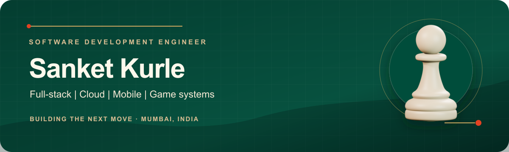

 

## About me

I’m a **Software Development Engineer at RigelX Infotech** in Mumbai. I build production applications across frontend, backend, cloud, mobile, real-time systems, and interactive game experiences.

I enjoy turning an ambiguous real-world problem into software that feels clear, fast, and dependable - from the first interface to the database, deployment, and production fixes.

> **The current move:** building useful products, learning from real users, and leaving every codebase stronger than I found it.

## Currently developing at RigelX

### RXForms

An intelligent dynamic form builder and workflow-automation product for teams that have outgrown spreadsheets. My work covers React and TypeScript interfaces, flexible data-capture experiences, and workflow-focused product development.

### RX Ware

A warehouse-management platform supporting multi-location inventory, inward and outward movement, batch and damage tracking, billing, tables, date-driven workflows, localisation, and role-based operations.

`React 19` · `TypeScript` · `Vite` · `Material UI` · `TanStack Table` · `i18next` · `Framer Motion` · `GSAP` · `Vitest` · `AWS CodeBuild`

### [ONDOT](https://ondotproperty.com/)

A property-discovery platform covering resale, rental, and new-project listings. The current web repository is frontend and static-site focused; I work on its search, location and listing flows, responsive UI, technical SEO, deployment, catalog automation, and the ONDOT backend now under development.

`Next.js 16` · `React 19` · `TypeScript` · `Python automation` · `S3` · `CloudFront` · `SEO validation` · `Backend APIs in development`

## Core technology

<strong>Frontend &amp; interactive experiences</strong>

 

`React` · `Next.js` · `TypeScript` · `JavaScript` · `Vite` · `Tailwind CSS` · `Material UI` · `Emotion` · `Three.js` · `React Three Fiber` · `WebGL` · `Responsive UI` · `Technical SEO`

<strong>Backend, real-time &amp; data</strong>

 

`C#` · `.NET` · `ASP.NET Core` · `SignalR` · `Entity Framework Core` · `Node.js` · `Express` · `NestJS` · `PostgreSQL` · `MySQL` · `MongoDB` · `Redis` · `Prisma`

<strong>Unity, mobile &amp; game development</strong>

 

`Unity` · `Unity C#` · `Unity 2D` · `URP 2D` · `Unity WebGL` · `JavaScript-Unity bridges` · `Game-state management` · `Gameplay rules` · `Flutter` · `Dart` · `Riverpod`

<strong>AI &amp; machine learning</strong>

 

`Machine Learning` · `Deep Learning` · `CNN` · `LSTM` · `BERT` · `OpenCV` · `DeepFace` · `RAG` · `LangChain` · `LangGraph`

<strong>Cloud, testing &amp; engineering tools</strong>

 

`AWS S3` · `CloudFront` · `ElastiCache` · `Azure` · `Docker` · `Playwright` · `xUnit` · `Vitest` · `Git` · `GitHub` · `Bitbucket` · `Jira` · `Blender`

## Selected projects

| Project | What I’m building | Technology |
| :--- | :--- | :--- |
| **Game Theory** · In development | A visual learning and multiplayer platform with an animated concept tree, interactive lessons, Unity WebGL experiences, accounts, and real-time game foundations. | Next.js · React · C# · .NET 10 · ASP.NET Core · SignalR · PostgreSQL · Unity · Playwright · xUnit |
| **Sports Group Management** · In development | A mobile coordination product replacing WhatsApp and spreadsheet workflows with session RSVPs, attendance, and a transaction-based shared-expense ledger. The first API prototype used NestJS; the backend is moving to ASP.NET Core. | Flutter · Riverpod · Firebase · PostgreSQL · NestJS prototype · ASP.NET Core planned |

## Engineering impact

- Delivered **5+ production web applications** across property, warehouse, and business domains.
- Work across the complete delivery path: requirements, UI, APIs, data, deployment, testing, and production debugging.
- Built account systems, Google authentication, database migrations, background workers, and multiplayer integration tests in ASP.NET Core.
- Created WebGL-ready Unity lessons with C# gameplay rules and JavaScript interoperability.
- Mentored full-stack interns and led a **Smart India Hackathon** team for two years.

## Education &amp; selected credentials

- **B.E. Information Technology**, Honours in Artificial Intelligence and Machine Learning - University of Mumbai, 2026.
- **Zscaler Academy** - Zero Trust Associate (ZTCA), valid through February 2029.
- **AWS Academy** - AI/ML Virtual Internship and Data Engineering Virtual Internship.
- **Google for Developers** - Android Developer Virtual Internship.
- **Oracle Academy** - Database Foundations.
- **NPTEL / IIT Kharagpur** - Introduction to Automata, Languages and Computation.
- **NPTEL / IIT Madras** - The Joy of Computing Using Python.
- **HackerRank** - Problem Solving (Basic).
- **Fortinet** - Network Security Associate Virtual Internship.

---

### Have an interesting problem to solve?

[Email me](mailto:sanketkurle567@gmail.com) · [Connect on LinkedIn](https://www.linkedin.com/in/sanket-kurle/) · [Explore my repositories](https://github.com/Sanket-Kurle?tab=repositories)

Full-stack engineering · cloud · mobile · game development

