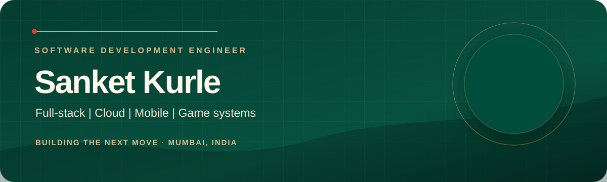

 

## About me

I’m a **Software Development Engineer at RigelX Infotech** in Mumbai. I build production applications across frontend, backend, cloud, mobile, real-time systems, and interactive game experiences.

I enjoy turning an ambiguous real-world problem into software that feels clear, fast, and dependable—from the first interface to the database, deployment, and production fixes.

> **The current move:** building useful products, learning from real users, and leaving every codebase stronger than I found it.

## Currently building

- **Nash Arena** — an animated game-theory learning and multiplayer platform using Next.js, ASP.NET Core, SignalR, PostgreSQL, C#, and Unity WebGL.
- Property search, listing, location, responsive UI, and SEO workflows for [ONDOT](https://ondotproperty.com/).
- Warehouse-management workflows covering multi-location inventory, inward/outward movement, batch and damage tracking, billing, and role-based access.
- Open-source improvements for the [Lichess mobile application](https://github.com/lichess-org/mobile/pull/2224).

## Core technology

<strong>Frontend &amp; interactive experiences</strong>

 

`React` · `Next.js` · `TypeScript` · `JavaScript` · `Vite` · `Tailwind CSS` · `Material UI` · `Emotion` · `Three.js` · `React Three Fiber` · `WebGL` · `Responsive UI` · `Technical SEO`

<strong>Backend, real-time &amp; data</strong>

 

`C#` · `.NET` · `ASP.NET Core` · `SignalR` · `Entity Framework Core` · `Node.js` · `Express` · `NestJS` · `Django REST Framework` · `PostgreSQL` · `MySQL` · `MongoDB` · `Redis` · `Prisma`

<strong>Unity, mobile &amp; game development</strong>

 

`Unity` · `Unity C#` · `Unity 2D` · `URP 2D` · `Unity WebGL` · `JavaScript–Unity bridges` · `Game-state management` · `Gameplay rules` · `Flutter` · `Dart` · `Riverpod`

<strong>AI, machine learning &amp; blockchain</strong>

 

`Machine Learning` · `Deep Learning` · `CNN` · `LSTM` · `BERT` · `OpenCV` · `DeepFace` · `RAG` · `LangChain` · `LangGraph` · `Solidity` · `Hardhat` · `ethers.js`

<strong>Cloud, testing &amp; engineering tools</strong>

 

`AWS S3` · `CloudFront` · `ElastiCache` · `Azure` · `Docker` · `Playwright` · `xUnit` · `Vitest` · `Git` · `GitHub` · `Bitbucket` · `Jira` · `Blender`

## Featured work

| Project | What I built | Technology |
| :--- | :--- | :--- |
| **Nash Arena** · In development | A visual game-theory learning platform with animated concept maps, Unity lessons, accounts, and real-time multiplayer foundations. | Next.js · C# · ASP.NET Core · SignalR · PostgreSQL · Unity |
| **[Mind-Med](https://github.com/Sanket-Kurle/Mind-Med)** · **[Live ↗](https://mind-med.vercel.app)** | A mental-health platform combining questionnaire, audio, facial-expression, and text-analysis workflows. | React · Django · PostgreSQL · Supabase · CNN/LSTM · BERT |
| **[TrustLedger](https://github.com/Sanket-Kurle/trustLedger)** | A transparent fundraising platform with campaign workflows and blockchain-backed donation records. | Next.js · Node.js · Prisma · Solidity · Hardhat · ethers.js |
| **[Lichess Mobile](https://github.com/lichess-org/mobile/pull/2224)** | Open-source contributions within the official Lichess Flutter application. | Flutter · Dart · Open source |

## Engineering impact

- Delivered **5+ production web applications** across property, warehouse, and business domains.
- Work across the complete delivery path: requirements, UI, APIs, data, deployment, testing, and production debugging.
- Built account systems, Google authentication, database migrations, background workers, and multiplayer integration tests in ASP.NET Core.
- Created WebGL-ready Unity lessons with C# gameplay rules and JavaScript interoperability.
- Mentored full-stack interns and led a **Smart India Hackathon** team for two years.
- Wrote about practical React architecture for the [RigelX engineering blog](https://www.rigelx.io/blog/).

## Education &amp; credentials

- **B.E. Information Technology**, Honours in Artificial Intelligence and Machine Learning — University of Mumbai, 2026.
- Google for Developers — Android Developer Virtual Internship.
- AWS Academy — Data Engineering and AI/ML Virtual Internships.
- NPTEL — Introduction to Automata, Languages and Computation.
- NPTEL — The Joy of Computing Using Python.

---

### Have an interesting problem to solve?

[Email me](mailto:sanketkurle567@gmail.com) · [Connect on LinkedIn](https://www.linkedin.com/in/sanket-kurle/) · [Explore my repositories](https://github.com/Sanket-Kurle?tab=repositories)

Full-stack engineering · cloud · mobile · game development · open source

