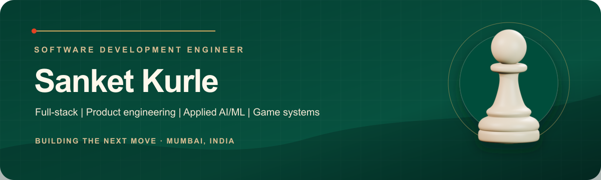

 

## About me

I’m a **Software Development Engineer at [RigelX Infotech](https://www.rigelx.io/)** in Mumbai. I build production applications across frontend, backend, databases, mobile, real-time systems, and interactive game experiences, with a growing focus on applied AI/ML.

I enjoy turning an ambiguous real-world problem into software that feels clear, fast, and dependable - from the first interface to the database, deployment, and production fixes.

> **The current move:** building useful products, learning from real users, and leaving every codebase stronger than I found it.

**Early-stage startup experience:** I help build products from the ground up, working through ambiguity and taking ownership from product discovery and architecture to implementation, deployment, and iteration from real customer feedback.

## Currently developing at RigelX

### [RXFORM](https://app.rxform-dev.rigelx.io/)

The inbox behind a website's existing contact and enquiry forms, built for small businesses that need every customer message to arrive reliably without running their own server. RXFORM saves each submission before delivery, sends alerts only to confirmed recipients, and provides per-form inboxes with search, spam protection, deletion and CSV export.

I contribute to the React and TypeScript product experience across onboarding, form setup, recipient management and submission workflows as the first release moves through final testing toward launch.

### [RX Ware](https://stg-wms.rigelx.io/)

A warehouse-management platform supporting multi-location inventory, inward and outward movement, batch and damage tracking, billing, tables, date-driven workflows, localisation, and role-based operations.

I contribute across both the frontend and backend, completing assigned feature and bug-fix tickets within the existing product codebase and its automated test suites.

**Frontend:** `React 19` · `TypeScript` · `Vite` · `Material UI` · `TanStack Table` · `i18next` · `Framer Motion` · `GSAP`

**Backend:** `TypeScript` · `Node.js 22` · `Express 5` · `AWS Lambda` · `API Gateway` · `PostgreSQL / Supabase` · `Kysely` · `CIAM / JWT` · `S3` · `SQS` · `CloudWatch` · `Vitest`

### [ONDOT](https://ondotproperty.com/)

A property-discovery platform covering resale, rental, and new-project listings. The current web repository is frontend and static-site focused; I work on its search, location and listing flows, responsive UI, technical SEO, deployment, and catalog automation. I am also actively participating in implementing ONDOT's backend APIs and database layer for property-submission, validation, persistence, and media workflows.

`Next.js 16` · `React 19` · `TypeScript` · `Python automation` · `S3` · `CloudFront` · `SEO validation` · `Backend APIs and database layer in development`

## Core technology

<strong>Frontend &amp; interactive experiences</strong>

 

`React` · `Next.js` · `TypeScript` · `JavaScript` · `Vite` · `Tailwind CSS` · `Material UI` · `Emotion` · `Three.js` · `React Three Fiber` · `WebGL` · `Responsive UI` · `Technical SEO`

<strong>Backend, real-time &amp; data</strong>

 

`C#` · `.NET` · `ASP.NET Core` · `SignalR` · `Entity Framework Core` · `Node.js` · `Express` · `NestJS` · `PostgreSQL` · `MySQL` · `MongoDB` · `Redis` · `Prisma`

<strong>Unity, mobile &amp; game development</strong>

 

`Unity` · `Unity C#` · `Unity 2D` · `URP 2D` · `Unity WebGL` · `JavaScript-Unity bridges` · `Game-state management` · `Gameplay rules` · `Flutter` · `Dart` · `Riverpod`

<strong>Applied AI &amp; machine learning</strong>

 

`Machine Learning` · `Deep Learning` · `CNN` · `LSTM` · `BERT` · `OpenCV` · `DeepFace` · `RAG` · `LangChain` · `LangGraph`

<strong>Testing, infrastructure exposure &amp; engineering tools</strong>

 

`Playwright` · `xUnit` · `Vitest` · `Docker` · `Git` · `GitHub` · `Bitbucket` · `Jira` · `Blender`

Working exposure through product delivery: `AWS Lambda` · `API Gateway` · `S3` · `SQS` · `CloudWatch` · `CloudFront` · `Azure fundamentals`

## Selected projects

| Project | What I’m building | Technology |
| :--- | :--- | :--- |
| **Game Theory** · In development | A visual learning and multiplayer platform with an animated concept tree, interactive lessons, Unity WebGL experiences, accounts, and real-time game foundations. | Next.js · React · C# · .NET 10 · ASP.NET Core · SignalR · PostgreSQL · Unity · Playwright · xUnit |
| **Sports Group Management** · In development | A mobile coordination product replacing WhatsApp and spreadsheet workflows with session RSVPs, attendance, and a transaction-based shared-expense ledger. The first API prototype used NestJS; the backend is moving to ASP.NET Core. | Flutter · Riverpod · Firebase · PostgreSQL · NestJS prototype · ASP.NET Core planned |

## Open-source contribution

### [Lichess Mobile - tablet clock orientation](https://github.com/lichess-org/mobile/pull/2224)

Fixed clock misorientation on tablets in the Flutter-based Lichess mobile application. The pull request was accepted and merged into `lichess-org/mobile:main` on October 1, 2025.

`Flutter` · `Dart` · `Responsive tablet UI` · `Open-source collaboration`

## Engineering impact

- Delivered **5+ production web applications** across property, warehouse, and business domains.
- Helped take early-stage products from idea to production while working directly across product, engineering, deployment, and customer-driven iteration.
- Work across the complete delivery path: requirements, UI, APIs, data, deployment, testing, and production debugging.
- Built account systems, Google authentication, database migrations, background workers, and multiplayer integration tests in ASP.NET Core.
- Created WebGL-ready Unity lessons with C# gameplay rules and JavaScript interoperability.
- Mentored full-stack interns and led a **Smart India Hackathon** team for two years.

## Education &amp; selected credentials

- **B.E. Information Technology**, Honours in Artificial Intelligence and Machine Learning - University of Mumbai, 2026.
- **Zscaler Academy** - Zero Trust Associate (ZTCA), valid through February 2029.
- **AWS Academy** - AI/ML Virtual Internship and Data Engineering Virtual Internship.
- **Google for Developers** - Android Developer Virtual Internship.
- **Oracle Academy** - Database Foundations.
- **NPTEL / IIT Kharagpur** - Introduction to Automata, Languages and Computation.
- **NPTEL / IIT Madras** - The Joy of Computing Using Python.
- **HackerRank** - Problem Solving (Basic).
- **Fortinet** - Network Security Associate Virtual Internship.

---

### Have an interesting problem to solve?

[Email me](mailto:sanketkurle567@gmail.com) · [Connect on LinkedIn](https://www.linkedin.com/in/sanket-kurle/) · [Explore my repositories](https://github.com/Sanket-Kurle?tab=repositories)

Full-stack product engineering · applied AI/ML · mobile · game development

